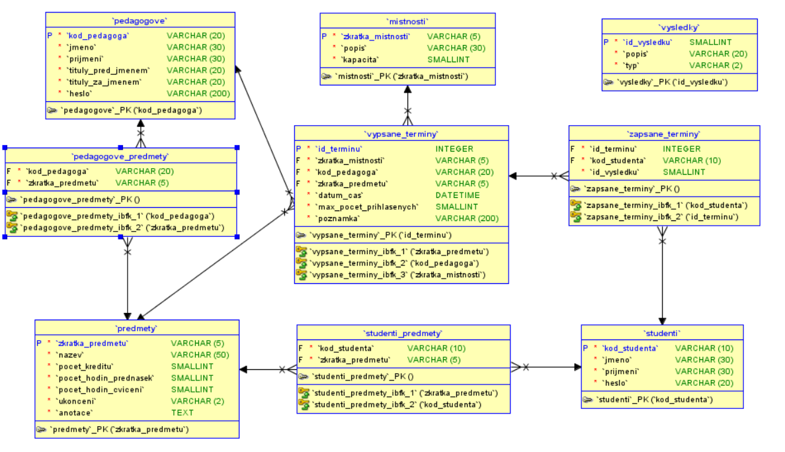

# Webové a databázové aplikace — KIP/7VYDA

Studijní podklady pro ZS 2026/2027, Ostravská univerzita. Export z přihlášeného [kurzu v Moodlu](https://moodle.osu.cz/course/view.php?id=12051) aktualizovaný dne **10. 11. 2026**. V úvodu kurzu je uveden RNDr. Bogdan Walek, Ph.D.

## Řešení úkolu 2

Samostatný skript [ukol2.php](../ukol2.php) obsahuje obě funkce a demonstrační výpisy. Stránka používá pouze základní HTML a výpisy přes `echo` a `print_r`, bez tabulek a CSS. Funkce `format_youtube_url($url)` je napsaná na jednom řádku pomocí `str_replace` a převádí zadaný tvar `https://www.youtube.com/watch?v=...` na `https://www.youtube.com/embed/...`. Funkce `get_working_days($from, $to)` vrací pole dat od pondělí do pátku včetně obou hranic intervalu; svátky nevynechává. Ukázky zahrnují tři YouTube adresy, všechny tři intervaly z přiloženého zadání a samostatný víkend s prázdným výsledkem.

Spuštění v místním XAMPP: zapnout Apache a otevřít [localhost/vyda/ukol2.php](http://localhost/vyda/ukol2.php). Alternativně z kořene projektu spustit `php -S 127.0.0.1:8000` a otevřít `http://127.0.0.1:8000/ukol2.php`. Funkce a ukázková data se upravují přímo v `ukol2.php`; původní cvičení v `index.php` a `form.php` zůstávají zachována.

Ověřeno dne **15. 10. 2026**: kontrola syntaxe `php -l ukol2.php` v PHP 8.2.12, 13 kontrol funkcí (včetně přesného příkladu, jednodenních a obrácených intervalů, víkendu, přelomu roku, přestupného dne a změn času) a výstup skriptu přes HTTP. Všechny tři dvojice YouTube adres a úplné výpisy čtyř polí odpovídají očekávaným výsledkům; intervaly mají postupně 6, 22, 15 a 0 pracovních dnů. Kontrola potvrdila také jednořádkový zápis první funkce.

Podkladem je [vyda-ukol-2.pdf](materialy/vyda-ukol-2.pdf), příloha dodaná uživatelem dne **15. 10. 2026** pod tímto původním názvem. Jde o aktuální zadání s funkcemi `format_youtube_url` a `get_working_days` a příklady pro rok 2026. Archivní `materialy/ukol2.pdf` i korespondenční úkol 2 z exportu Moodlu jsou samostatné podklady a nebyly přepsány.

## Orientace v podkladech

- [Výpis celé stránky kurzu](kurz.md) — text všech 10 viditelných sekcí, cíle kapitol, průvodce studiem, shrnutí a kontrolní otázky.
- [Katalog materiálů](materialy.md) — odkazy na 8 aktuálně dostupných souborů a dvě obrázkové přílohy zadání.
- [Archivní základní informace z 12. 10. 2026](export/zakladni-informace.txt) — původní požadavky na absolvování, přehled výuky a literatura; tato stránka již není v aktuální osnově dostupná.
- [Korespondenční úkol 1](export/korespondencni-ukol-1.txt), [korespondenční úkol 2](export/korespondencni-ukol-2.txt), [semestrální projekt](export/semestralni-projekt.txt) — úplná zadání včetně termínů.
- [Aktuální textový výpis](export/kurz.txt), [struktura sekcí](export/sekce.json), [odkazy ze stránky](export/odkazy.json) a [manifest souborů](export/materialy.json) — podklady pro ověření exportu.
- [Kontrolní součty](export/kontrolni-soucty.csv) — velikosti a SHA-256 stažených materiálů.

## Souhrn kurzu

Aktuální Moodle je rozdělen do pěti výukových kapitol: HTTP a HTML formuláře; operátory, příkazy a cykly; databáze v PHP; OOP a frameworky; Nette. Nové prezentace pokrývají také bezpečné zpracování vstupu, parametrizované dotazy mysqli/PDO, strict types, předávání závislostí, generátory, dekorátory a autentizaci a autorizaci. Jde o souhrn obsahu zdroje, nikoli nezávislé ověření tvrzení v prezentacích.

V [materialy/2026-11-10/](materialy/2026-11-10/) je nově stažených pět prezentací PPTX, dvě PDF zadání samostatných úkolů a SQL podklad. K tomu jsou uložena schémata z korespondenčního úkolu 2 a semestrálního projektu. SQL podklad je uložen beze změny obsahu jako `.sql.txt`. Obrázek k projektu je dostupný i přímo níže:

Původní studijní opora, kapitoly a staré prezentace zůstávají zachované v [archivním katalogu](materialy-archiv-2026-10-12.md). Původní textové exporty a manifest jsou v [export/archiv-2026-10-12/](export/archiv-2026-10-12/). Aktuální a archivní podklady jsou tak rozlišeny; případné soubory dodané uživatelem zůstávají zachované.

## Povinnosti a termíny

Podle archivních základních informací jsou požadovány dva průběžné korespondenční úkoly a semestrální projekt, který se prezentuje u zápočtu. Následující časy jsou převzaté ze zobrazení Moodlu při aktualizaci 10. 11. 2026:

| Zadání | Termín | Hlavní požadavky |
| --- | --- | --- |
| Korespondenční úkol 1 | 10. 11. 2026, 23:59 | Formulář pro vyhledávání hardwaru, alespoň 5 parametrů a 4 druhy prvků; odeslání na stejný skript a tabulkový výpis hodnot. |
| Korespondenční úkol 2 | 1. 12. 2026, 23:55 | Tabulka předmětů v databázi, formulář pro vložení záznamu, kontrola vstupu a výpis obsahu tabulky. |
| Semestrální projekt | 7. 12. 2026, 23:55 | PHP/MySQL aplikace pro přihlašování studentů na termíny zápočtů a zkoušek. |

Projekt rozlišuje přihlášeného pedagoga a studenta. Vyžaduje alespoň pět pedagogů a pět studentů s funkčními účty a přiřazenými předměty. Pedagog spravuje termíny svých předmětů; nové termíny musí být v budoucnosti. Student se přihlašuje a odhlašuje, nesmí překročit kapacitu, přihlásit se duplicitně ani mít více platných termínů stejného předmětu. Zadávání hodnocení je nepovinné. Dílčí úpravy referenčního schématu musí být zdůvodněny při obhajobě.

## Rozsah a omezení exportu

- Sekce **Cvičení soubory a úkoly — pouze pro prezenční studenty** a **Vzorové příklady XVYDA a 2VYDA** jsou v této session označené jako **Není dostupné**. Jejich obsah ani případné skryté přílohy nebyly přístupné a nejsou součástí exportu.
- Fórum [Oznámení](export/oznameni.txt) při exportu neobsahovalo žádná oznámení.
- [XAMPP](export/xampp.txt) je externí odkaz na Apache Friends; instalátor není studijní přílohou a není archivován.
- Export obsahuje text výukového obsahu a zadání, nikoli osobní stav odevzdání, známky či údaje přihlášeného účtu.
- Archivní podklady zachovávají historickou terminologii a funkce. Pro aktuální osnovu použijte export a materiály ze dne 10. 11. 2026.

## Větve repozitáře

Tato aktualizace je na nejnovější pracovní větvi `cv7-10.11.2026` v repozitáři na Proton Drive. Výchozí větev repozitáře je `main`; tato aktualizace ji nemění. Vlastní implementace cvičení a úkolů je na pracovních větvích.
